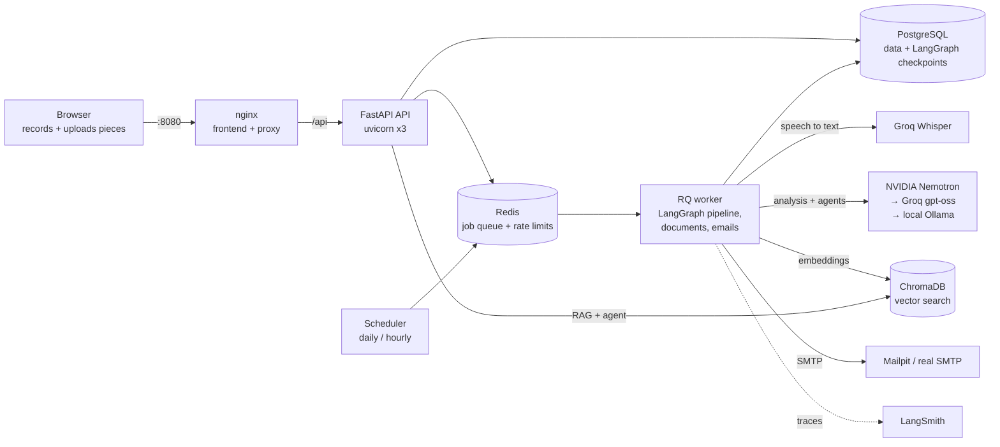
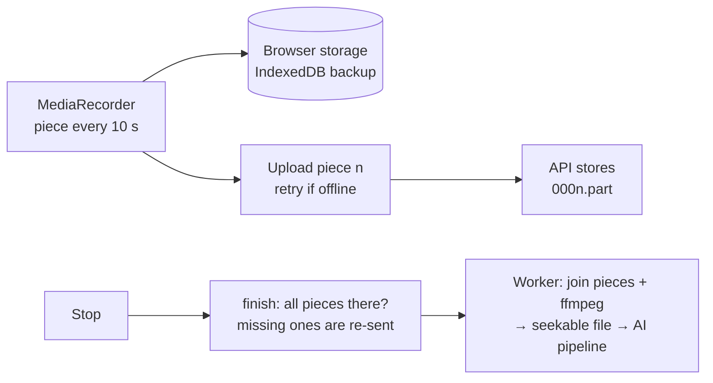
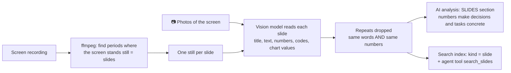
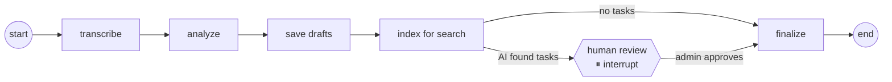
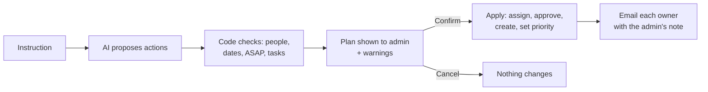
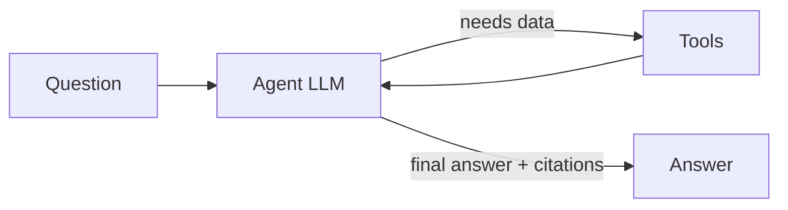

<div align="center">


# MeetMind

**Record a meeting in the browser (or upload it) and MeetMind turns it into a summary, decisions,
questions and answers, and tasks with owners and deadlines. Ask it anything afterwards. Open-source AI models.**


📘 **New here? Read the easy guide first: [docs/GUIDE.md](docs/GUIDE.md)**

</div>

---

## Contents

1. [What MeetMind does](#1-what-meetmind-does)
2. [How it works](#2-how-it-works)
3. [Tools and technologies (and why each one)](#3-tools-and-technologies-and-why-each-one)
4. [AI models](#4-ai-models)
5. [Recording meetings in the browser](#5-recording-meetings-in-the-browser)
6. [The AI pipeline step by step](#6-the-ai-pipeline-step-by-step)
7. [Task assistant (assign tasks by telling the AI)](#7-task-assistant-assign-tasks-by-telling-the-ai)
8. [RAG: search across meetings and documents](#8-rag-search-across-meetings-and-documents)
9. [The multi-tool AI assistant (agent)](#9-the-multi-tool-ai-assistant-agent)
10. [Reminders and emails](#10-reminders-and-emails)
11. [Project structure](#11-project-structure)
12. [Getting started](#12-getting-started)
13. [Configuration (.env)](#13-configuration-env)
14. [API reference](#14-api-reference)
15. [Security](#15-security)
16. [Testing](#16-testing)
17. [Useful commands](#17-useful-commands)
18. [Troubleshooting](#18-troubleshooting)
19. [Roadmap: done and next](#19-roadmap-done-and-next)

---

## 1. What MeetMind does

| Feature | What you get |
|---|---|
| 🔴 **Record in the browser** | Press *Record* during the meeting. **In the room** (laptop or conference microphone), **online** (sound of Zoom/Teams/Meet + your mic) or **online + screen** (video). Saved piece by piece while recording, so a dropped network or closed laptop loses almost nothing. |
| 🎯 **Focus recording screen** | Full-screen recorder: big timer, live sound wave, notes box, keyboard shortcuts (**Space** pause, **M** mark, **N** note, **Esc** minimise). Other tabs show a "recording in progress" banner. |
| ⚡ **Instant meetings** | *Record a meeting now* creates a meeting that starts immediately. |
| 🖥️ **Presentations on the big screen** | Record the room **+ the presentation screen**, or 📷 snap the screen with a camera or phone. AI reads every slide (titles, numbers, codes, charts), so summaries say *"from 4.2% to under 1%"*, not *"this number"*. PowerPoint decks can be attached. |
| 📝 **Live notes** | Anyone in the meeting can type notes or press ⭐ *Mark this moment*. Notes are time-stamped and given to the AI with the recording. |
| ⬆️ **Upload** | Or upload MP3, WAV, M4A, MP4, WEBM, OGG, FLAC, MOV (up to 500 MB). |
| 🎙️ **Transcription** | A timestamped transcript. Click any line to play the recording from there. |
| 📋 **Summary, decisions, strategy** | What was discussed and the **final** decisions (if a later answer changed the plan, the final outcome wins). |
| ❓ **Questions & answers** | Every question asked during the meeting, including sudden follow-ups from the room, and the answer given. |
| ✅ **Tasks with owners, deadlines and priority** | Each with the exact quote it came from. "ASAP" becomes a real date and is marked **urgent**. |
| 🤖 **Task assistant** | Tell the AI *"Give the docs to Maya and the demo to Jordan, ASAP"*. It shows a plan; you confirm; owners are emailed. |
| 📎 **Documents & bug reports** | Attach PDFs, Word files, Markdown, logs… The assistant answers from them. |
| 💬 **Ask MeetMind** | Ask about one meeting or **all** meetings. A multi-tool AI agent searches transcripts, notes, documents, tasks and other meetings, and cites its sources. |
| ⏰ **Reminders** | Owners get emails before deadlines and when overdue; admins get a daily "what's important" summary. |
| 📊 **Dashboard** | *Needs attention* (overdue and urgent tasks, reviews, failed processing, open recordings, starred recordings), tasks-by-status and workload-per-person charts, next 7 days. |
| 🗂️ **Tasks board** | To do · In progress · Done. Drag cards or use the status menu; filter by text, priority, owner and due date. Admins see the team, members their own tasks. |
| 👥 **Teams & roles** | Each company has its own workspace. Admins manage everything; members see meetings they attended and their own tasks. |
| 📱 **Responsive** | Desktop and phone. Dark mode follows the device or the theme switch in the sidebar. |

---

## 2. How it works



- **nginx** serves the website and forwards `/api/...` to the backend.
- The **API** (FastAPI) handles logins, meetings, recordings, notes, documents, tasks and questions. Slow work never runs inside a web request.
- Slow work (joining recording pieces, transcription, AI analysis, reading documents, emails) goes to a **Redis queue**; the **worker** does it.
- The **scheduler** queues the daily reminder emails and an hourly clean-up of interrupted recordings.
- The worker runs the **LangGraph pipeline**, saves results in **PostgreSQL**, indexes them in **ChromaDB**, and **pauses** for the admin's review.

---

## 3. Tools and technologies (and why each one)

### Backend

| Tool | What it is | Why MeetMind uses it |
|---|---|---|
| **Python 3.11** | Programming language | The standard language for AI tools. |
| **FastAPI** | Web framework | Fast, validates every request, and creates interactive API docs at `/api/docs`. |
| **Uvicorn** | Web server | Runs FastAPI with 3 processes. |
| **Pydantic v2 / pydantic-settings** | Validation and settings | Checks every request body; reads all configuration from `.env`. |
| **SQLAlchemy 2 + Alembic** | Database toolkit + migrations | Talks to PostgreSQL; versioned schema changes applied by a one-shot `migrate` container. |
| **PostgreSQL 16** | Database | Organizations, users, meetings, notes, documents, tasks, assistant runs, LangGraph checkpoints. |
| **Redis 7 + RQ** | Queue | Background jobs with retries; shared rate-limit counters (sliding window). |
| **argon2 + PyJWT** | Security | Password hashing and expiring login tokens. |
| **Jinja2** | Templates | HTML + text emails, auto-escaped. |
| **ffmpeg** | Audio/video tool | Joins recording pieces into a seekable file, converts audio to small chunks for transcription. |
| **pypdf, python-docx** | Document readers | Extract text from attached PDF and Word files. |

### AI and LLM stack

| Tool | What it is | Why MeetMind uses it |
|---|---|---|
| **LangChain** | Standard interface for LLMs | NVIDIA, Groq and Ollama models are used the same way; switching models is configuration. |
| **LangGraph** | AI workflows as graphs | The meeting pipeline (with a **pause for human review**) and the **tool-using agent** are LangGraph graphs. |
| **LangSmith** | Tracing | See every pipeline run, agent step, tool call, prompt and timing (optional). |
| **NVIDIA AI endpoints** | Hosted open models | **Nemotron** for analysis, chat and **embeddings**. |
| **Groq** | Fast inference cloud | **Whisper large-v3** speech-to-text; **gpt-oss** as backup LLM and fast reranker. |
| **Ollama** | Models on your own computer | Optional last-resort backup (e.g. `gemma4`) and optional local embeddings. |
| **ChromaDB** | Vector database | Stores meeting/document chunks as embeddings for search by meaning. |

### Frontend and infrastructure

| Tool | What it is | Why MeetMind uses it |
|---|---|---|
| **HTML, CSS, JavaScript** | Plain web pages | No framework, nothing to build; one design system with dark mode. |
| **MediaRecorder + Web Audio API** | Browser recording | Records the microphone and/or another app's sound, mixes them, shows the sound level. |
| **Screen Capture API** | `getDisplayMedia` | Captures the meeting app's sound (and the screen for video). |
| **IndexedDB** | Browser storage | Keeps recorded pieces until the server confirms them (survives network drops). |
| **Wake Lock API** | Keep screen on | Stops the laptop sleeping during a recording. |
| **nginx, Docker Compose** | Proxy + containers | One command starts all 9 services. |
| **Mailpit** | Test inbox | Catches every email in development (<http://localhost:8025>). |
| **pytest + httpx** | Testing | 98 automated tests, inside Docker. |

---

## 4. AI models

Model names live in `.env`, so you can swap them without touching code.

| Job | Model (provider) | Fallback |
|---|---|---|
| Speech → text | `whisper-large-v3` (Groq) | n/a |
| Meeting analysis | `nvidia/nemotron-3.5-super-vl-120b-a12b` | `openai/gpt-oss-120b` (Groq) → `gemma4` (Ollama, optional) |
| Q&A, agent, task assistant | `nvidia/nemotron-3.5-lightning-30b-a3b` | `openai/gpt-oss-20b` (Groq) → `gemma4` (Ollama) |
| Reranking search results | `openai/gpt-oss-20b` (Groq, fastest) | NVIDIA chat model; off if neither |
| Reading slides (vision) | `qwen/qwen3.8-27b` (Groq, ~1 s per slide) | `nemotron-3.5-super-vl` (NVIDIA, 10–30 s) → `gemma4` (Ollama, ~1 min on CPU) |
| Embeddings (RAG) | `nvidia/nemotron-3.5-embed-1b` | *or* `embeddinggemma` via Ollama: **one at a time** (see below) |

**Fallback:** for answers, MeetMind tries each configured provider in order and records which model answered.
**Embeddings are different:** every model builds its own "map of meaning", so stored vectors and questions must use
the **same** model. Each model gets its own ChromaDB collection; after switching, run the reindex command.

> Cloud models get retired. `nemotron-3-embed-1b` was switched off by NVIDIA (HTTP 410) during development. MeetMind then
> shows a clear error, the assistant falls back to text search, and you set a new `NVIDIA_EMBEDDING_MODEL` + reindex.

---

## 5. Recording meetings in the browser

On a meeting page (or **Record a meeting now** on the dashboard), choose where the meeting is:

| Mode | Use it for | What is recorded |
|---|---|---|
| **In the room** | Conference room / meeting hall | The microphone. **Noise suppression is off by default**, so quieter voices and questions from the audience are kept; automatic gain lifts distant speakers. |
| **In the room + presentation** | Hall or conference room with a big screen / projector | The room microphone **+ the screen shown on the big screen** as low-frame-rate video (5 fps, ~300 MB per hour). Every slide is captured and read by AI. |
| **Online meeting** | Zoom, Teams, Meet on the same computer | The meeting's sound (share the tab with *Share tab audio*, or the screen with *Share system audio*) **+ your microphone**, mixed. |
| **Online + screen** | Presentations, demos | The above + the screen as video. |

While recording, a **focus screen** fills the window: a big timer, a **live sound wave** (warns "very quiet, move closer
or use an external mic"), **Pause/Resume**, **⭐ Mark this moment**, a notes box (time-stamped automatically) and
**Stop & process**.

| Key | Action |
|---|---|
| `Space` | Pause / resume |
| `M` | Mark this moment ⭐ |
| `N` | Write a note |
| `S` | 📷 Snap the big screen (camera photo, saved at this moment of the recording) |
| `Esc` | Minimise (a red bar with the timer and *Stop* stays at the top of the page) |

After *Stop*, the meeting page shows the real progress: **Recorded → Preparing audio → Transcribing → Analysing → Ready**.

**Why it's reliable**



- Pieces are uploaded **during** the meeting: a 2-hour meeting never depends on one huge upload.
- Offline? Pieces wait in the browser and upload when the network is back. Re-sending a piece is harmless.
- Tab closed or laptop died? Pieces in the browser are uploaded next time the page opens; anything the server already
  has is processed automatically by the hourly **rescue** job.
- The screen stays awake during recording; closing the tab asks for confirmation.

### Presentations on the big screen

In a hall, people explain what is on the LED wall or projector: *"as you can see, this number is far too high"*.
The audio alone doesn't say which number. MeetMind captures the screen too:

| Way in | When to use it |
|---|---|
| **In the room + presentation** mode | The laptop running MeetMind is the one connected to the big screen. |
| **📷 Snap screen** (or key `S`) | Another computer drives the screen: photograph it with the laptop or phone camera. Anyone in the meeting can also add a photo from their phone (Slides tab). |
| **Attach the deck** | The presenter has the file: PDF or **PowerPoint (`.pptx`)** under Documents (text, tables and speaker notes per slide). |



- A slide is found as a period where the screen **stands still** (≥ 2 s). This works even when every slide uses the
  same template: there the "picture change" score is tiny (about 0.05), so change detection alone missed slides.
- A slide is **never** a decision or task by itself; tasks still need a quote of what people said or typed.
- Slides appear on the **Slides** tab (image, time, what AI read), as markers in the transcript, and as sources in answers
  (*"🖼 Slide shown at 00:00:16"* with a link to it). Slide reading never blocks processing: if it fails, the meeting is
  still processed.

**Browser support:** recording the microphone works in all modern browsers. Capturing another app's sound needs
**Chrome or Edge** on a computer (tab audio everywhere; whole-system audio on Windows). In production, MeetMind must be
served over **HTTPS** (browsers only allow microphones on secure sites; `localhost` is fine).

---

## 6. The AI pipeline step by step



1. **transcribe**: a browser recording is first joined into one file. ffmpeg converts the audio to small 16 kHz mono
   chunks; Groq Whisper transcribes each; timestamps are lined up; participant names are spelling hints.
2. **analyze**: one structured LLM call reads the transcript **and the notes typed during the meeting** and returns
   summary, final decisions, **follow-up questions and answers**, open questions and tasks (with owner, spoken deadline,
   priority and a quote). The prompt treats transcript and notes as **data, not instructions** (prompt-injection safe).
3. **save drafts**: code checks the model instead of trusting it:
   - every task must quote the transcript **or a note**, otherwise it is dropped;
   - owners are matched to real participants, tolerating speech-to-text typos ("Mya" → Maya); unclear → admin decides;
   - **deadlines are calculated in Python** from the spoken words, in the meeting's own time zone;
     "ASAP / urgent / immediately" = `ASAP_WORKING_DAYS` working days later and priority **urgent**;
   - "unknown" speakers are left empty; duplicate tasks merged; deadlines removed from titles.
4. **index**: summary, decisions, Q&A, notes and transcript are added to ChromaDB (retried in the background if that fails).
5. **human review** ⏸: LangGraph `interrupt()` pauses and saves the run in Postgres. Members can't see drafts yet.
6. **finalize**: approved tasks go to their owners (email), rejected drafts are deleted.

**Statuses:** `scheduled → recording → processing → review → completed` (or `failed`, with the reason and **Retry**).

---

## 7. Task assistant (assign tasks by telling the AI)

The admin types (on the meeting page) what should happen:

> *"Give the payment bug to Maya and the release notes to Alex. Everything ASAP, tell them it's urgent."*



- The AI only **proposes**. Code resolves people (must be in the team), computes dates (ASAP → working days, urgent),
  and turns anything unclear into a visible warning ("Couldn't match 'Sam' to one person").
- **Nothing changes and nobody is emailed until the admin clicks Confirm.**
- If all AI drafts are handled, the paused review is closed automatically.
- Every instruction and its result is kept as an **audit log** (`agent_runs` table).
- Owners get an email with an **URGENT** badge and the admin's note. If the AI writes a report ("Tasks 1 and 2 have been
  assigned…") instead of a note to the owners, code replaces it with a proper note.

---

## 8. RAG: search across meetings and documents

**RAG** (Retrieval-Augmented Generation) = first **find** the relevant pieces of your own data, then let the AI
**answer only from them**, with citations.

| Step | What happens |
|---|---|
| **Chunking** | Transcripts are cut into ~1-minute chunks (with overlap and timestamps). Each meeting also gets a **notes** chunk (summary, decisions, Q&A, typed notes). Documents are chunked page by page. |
| **Embeddings** | Each chunk becomes a vector (NVIDIA `nemotron-3.5-embed-1b`, or `embeddinggemma` via Ollama). |
| **Vector store** | ChromaDB stores vectors + metadata: organization, meeting, title, date, time zone, timestamps, document name, page. |
| **Hybrid search** | Meaning-based search + keyword search (names, numbers, error codes), merged with Reciprocal Rank Fusion. |
| **Filters** | Organization, the user's meetings (members), kind (transcript / notes / document) and **date range** ("last month"). |
| **Reranking** | A fast LLM re-orders the candidates and keeps the truly relevant ones (no reranker model needed). |
| **Answer** | Only from the numbered sources, citing `[1][3]`; only cited sources are returned; each links to the meeting, the exact moment (▶ play) or the document page. |
| **Follow-ups** | Earlier turns are sent along, so "and who owns that?" works. |
| **Resilience** | If indexing fails it retries in the background; if embeddings are down, keyword search still works, and the agent falls back to **text search in the database**. |

Re-index everything (e.g. after changing the embedding model): `docker compose exec worker python -m meetmind.jobs reindex`

---

## 9. The multi-tool AI assistant (agent)

Both chats (*Ask about this meeting* and *Ask MeetMind*) use a **LangGraph tool-calling agent**:



| Tool | Answers from |
|---|---|
| `search_meeting` | the current meeting's transcript, notes, decisions and Q&A |
| `search_documents` | attached documents, documentation and bug reports |
| `search_meetings` | all meetings the user can see, optionally in a date range |
| `list_tasks` | the task database (owner, status, priority, overdue) |
| `list_meetings` | the list of meetings |
| `get_meeting_details` | one meeting's full notes |

- The agent decides which tools to use. **If one source has nothing, it tries another** (meeting → documents →
  other meetings → tasks) before saying it couldn't find the answer. It never answers from general knowledge.
- Every tool applies the same **access rules** as the API (organization; members only see their meetings).
- The answer shows **where it looked** ("Looked in: documents, this meeting") and **numbered sources**.
- If every model fails, a simpler direct answer path is used. Agent steps are capped (`AGENT_MAX_STEPS`).
- Tested: *"What error code does the bug report show?"* → *"E-4021 'Card token expired' [1] 📄 bug-report.md, page 1"*.

---

## 10. Reminders and emails

| Email | To | When |
|---|---|---|
| Invite | invited person | an admin invites or re-invites them |
| Ready for review | the admin who created the meeting | the AI drafted tasks |
| New tasks for you | each owner with an account | tasks are approved (review or task assistant), with priority and the admin's note |
| Task reminder | each owner | tasks due today/tomorrow (once), overdue (every 3 days until done) |
| What's important today | admins | daily, **only if something needs attention**: meetings to review, failed processing, overdue and urgent tasks, starred ⭐ recordings, storage used |
| Processing failed | the meeting's admin | a recording could not be processed |

Reminders go out daily at `REMINDER_HOUR` in `REMINDER_TIMEZONE` (the `scheduler` container queues them once per day).
All recordings are kept; admins **star** the important ones so they stand out in the daily summary.

**Development:** every email lands in **Mailpit** (<http://localhost:8025>). **Real delivery**, e.g. Gmail: turn on
2-Step Verification, create an **App Password** (16 letters), then in `.env`:

```env
SMTP_HOST=smtp.gmail.com
SMTP_PORT=587
SMTP_STARTTLS=true
SMTP_USERNAME=you@gmail.com
SMTP_PASSWORD=your16letterapppassword
MAIL_FROM=MeetMind <you@gmail.com>
```

Never put your normal Google password in `.env`.

---

## 11. Project structure

```
MeetMind/
├── docker-compose.yml          # api, worker, scheduler, migrate, postgres, redis, chroma, nginx, mailpit
├── .env.example                # copy to .env and fill in
├── docs/GUIDE.md               # the easy guide: the whole project explained simply
├── nginx/nginx.conf
│
├── backend/
│   ├── Dockerfile, requirements*.txt, alembic.ini, migrations/
│   ├── meetmind/
│   │   ├── __init__.py         # FastAPI app factory
│   │   ├── config.py, models.py, schemas.py, serializers.py, deps.py, security.py, ratelimit.py
│   │   ├── media.py            # joins browser recording pieces; finds slides in screen recordings (ffmpeg)
│   │   ├── slides.py           # slide stills and photos: read, drop repeats, lines for the AI
│   │   ├── documents.py        # reads PDF/Word/PowerPoint/text documents
│   │   ├── reminders.py        # task reminders, admin digest, rescue of interrupted recordings
│   │   ├── scheduler.py        # queues daily/hourly jobs
│   │   ├── mailer.py, notifications.py, templates/email/
│   │   ├── jobs.py             # everything the worker runs
│   │   ├── api/                # auth, users, meetings, live (recording), notes, documents, slides,
│   │   │                       # tasks, assistant, search (RAG + agent), dashboard, health
│   │   └── ai/
│   │       ├── llm.py          # providers + fallback (NVIDIA → Groq → Ollama)
│   │       ├── transcription.py# ffmpeg + Groq Whisper
│   │       ├── analysis.py     # prompt, output schema, evidence/owner/date/ASAP checks
│   │       ├── pipeline.py     # LangGraph meeting pipeline with interrupt()
│   │       ├── vision.py       # reads slides with a vision model (Groq → NVIDIA → Ollama)
│   │       ├── rag.py          # chunking, embeddings, ChromaDB, hybrid search, rerank, cited answers
│   │       ├── agents.py       # multi-tool LangGraph agent (Q&A)
│   │       ├── task_agent.py   # task assistant: propose → check → confirm → apply
│   │       ├── checkpoint.py   # Postgres checkpointer
│   │       └── qa.py           # direct per-meeting answer (fallback)
│   └── tests/                  # 115 tests (fake AI models + in-memory vector store, no keys needed)
│
└── frontend/
    ├── index.html, signup.html, login.html, accept-invite.html
    ├── admin.html, member.html, create-meeting.html, meeting.html, tasks.html, ask.html
    ├── css/style.css, assets/
    └── js/
        ├── theme.js            # light / dark / same-as-device (loaded in <head>, no flash)
        ├── ui.js               # toasts, dialogs, mobile menu, drop zones
        ├── api.js, app.js, auth.js, tasks.js
        ├── recorder.js         # browser recorder: modes, mixing, level meter, piece upload, recovery
        └── pages/              # admin.js, member.js, meeting.js, board.js, create-meeting.js, ask.js
```

---

## 12. Getting started

### Prerequisites

- [Docker Desktop](https://www.docker.com/products/docker-desktop/)
- API keys (free tiers): **Groq** (<https://console.groq.com/keys>, needed for transcription) and
  **NVIDIA** (<https://build.nvidia.com>, key starts with `nvapi-`)
- Optional: **LangSmith** key, **Ollama** (<https://ollama.com>) for a local backup model
- For recording another app's sound: **Chrome or Edge**

### Run it

```bash
git clone https://github.com/tawfeeqimtiyaz/MeetMind.git
cd MeetMind
cp .env.example .env        # then set SECRET_KEY, POSTGRES_PASSWORD, GROQ_API_KEY, NVIDIA_API_KEY
docker compose up -d --build
docker compose ps           # all services should be Up
```

| Open | URL |
|---|---|
| MeetMind | <http://localhost:8080> |
| API docs | <http://localhost:8080/api/docs> |
| Mailpit (emails) | <http://localhost:8025> |

### First steps

1. **Get started** → create your workspace (you become admin) → **Team** → invite colleagues.
2. Dashboard → **Record a meeting now** → choose *In the room* or *Online* → **Start recording**. Type notes, mark moments.
3. **Stop & process** → about a minute later: summary, decisions, Q&A, draft tasks.
4. Review the drafts, or tell the **task assistant** who does what → **Confirm** → owners are emailed.
5. Attach documents, then ask questions in the meeting chat or **Ask MeetMind**.

---

## 13. Configuration (.env)

| Variable | Default | Meaning |
|---|---|---|
| `APP_ENV` | `production` | `development` logs invite links and shows API docs. |
| `SECRET_KEY` | (required) | Signs login tokens. At least 32 random characters. |
| `APP_BASE_URL` | `http://localhost:8080` | Public URL used in email links. |
| `CORS_ORIGINS`, `ALLOW_SIGNUP`, `JWT_EXPIRES_MINUTES` | | Browser origins, open sign-up, session length. |
| `MAX_UPLOAD_MB` / `MAX_LIVE_RECORDING_MB` / `MAX_DOCUMENT_MB` | `500` / `4000` / `25` | Size limits. |
| `POSTGRES_USER` / `POSTGRES_PASSWORD` / `POSTGRES_DB` | | Database. |
| `EMAIL_ENABLED`, `SMTP_*`, `MAIL_FROM` | Mailpit | Email (see section 10). |
| `REMINDER_HOUR` / `REMINDER_TIMEZONE` | `9` / `UTC` | When daily reminders go out (e.g. `Asia/Kolkata`). |
| `ASAP_WORKING_DAYS` | `2` | What "as soon as possible" means. |
| `NVIDIA_API_KEY`, `NVIDIA_ANALYSIS_MODEL`, `NVIDIA_CHAT_MODEL` | Nemotron 3.5 | NVIDIA models. |
| `GROQ_API_KEY`, `GROQ_ANALYSIS_MODEL`, `GROQ_CHAT_MODEL`, `GROQ_TRANSCRIPTION_MODEL` | gpt-oss, whisper | Groq models. |
| `OLLAMA_BASE_URL`, `OLLAMA_MODEL`, `OLLAMA_NUM_CTX` | off | Local backup model. |
| `GROQ_VISION_MODEL`, `NVIDIA_VISION_MODEL`, `OLLAMA_VISION_MODEL` | Qwen, Nemotron VL, `OLLAMA_MODEL` | Models that read slides (empty = skip that one). |
| `MAX_SLIDES_PER_RECORDING`, `SLIDE_MIN_GAP_SECONDS`, `SLIDE_SCENE_THRESHOLD`, `MAX_SLIDE_IMAGE_MB` | `60`, `4`, `0.03`, `10` | Slide capture tuning. |
| `CHROMA_URL` | `http://chroma:8000` | Vector database. |
| `EMBEDDING_PROVIDER` | `nvidia` | `nvidia` or `ollama` (reindex after switching). |
| `NVIDIA_EMBEDDING_MODEL` / `OLLAMA_EMBEDDING_MODEL` | `nemotron-3.5-embed-1b` / `embeddinggemma` | Embedding models. |
| `RAG_TOP_K`, `RAG_CHUNK_CHARS`, `RAG_FULL_CONTEXT_CHARS`, `RAG_RERANK` | `8`, `1200`, `40000`, `true` | Search tuning. |
| `AGENT_MAX_STEPS` | `8` | Tool calls the assistant may make per question. |
| `LANGSMITH_TRACING`, `LANGSMITH_API_KEY`, `LANGSMITH_PROJECT` | off | Tracing. |

> ⚠️ Never commit `.env`. It is in `.gitignore`.

---

## 14. API reference

Interactive docs: **<http://localhost:8080/api/docs>** (click **Authorize**, paste the token from `/api/auth/login`).

| Method | Endpoint | Who | Purpose |
|---|---|---|---|
| POST | `/api/auth/signup`, `/api/auth/login`, `/api/auth/accept-invite` | anyone | Workspace, login, invite |
| GET | `/api/auth/me`, `/api/dashboard` | signed in | Current user; stat cards + insights (needs attention, tasks by status, workload, upcoming) |
| GET/POST/PATCH | `/api/users`, `/api/users/invite`, `/api/users/{id}`, `/api/users/{id}/resend-invite` | admin | Team |
| GET/POST | `/api/meetings` · POST `/api/meetings/instant` | signed in / admin | List, create, start now |
| GET/PATCH/DELETE | `/api/meetings/{id}` | signed in / admin | View, edit, delete |
| POST | `/api/meetings/{id}/live-recordings` | admin | Start a browser recording |
| PUT | `/api/recordings/{id}/chunks/{n}` | admin | Upload piece *n* (safe to repeat) |
| POST | `/api/recordings/{id}/finish` | admin | All pieces sent → process |
| PATCH/DELETE | `/api/recordings/{id}` | admin | Star as important / delete |
| GET | `/api/recordings/{id}/playback` | signed in | Short-lived link for the player (supports seeking) |
| POST | `/api/meetings/{id}/recordings` | admin | Upload a file |
| GET/POST · DELETE | `/api/meetings/{id}/notes` · `/api/notes/{id}` | participants | Notes and ⭐ moments |
| GET/POST · DELETE | `/api/meetings/{id}/documents` · `/api/documents/{id}` | participants | Attach / list / delete documents |
| GET/POST · DELETE | `/api/meetings/{id}/slides` · `/api/slides/{id}` | participants | Slides; add a photo of the screen (`offset_seconds` optional) |
| GET | `/api/slides/{id}/image?token=` | signed link | Slide image (short-lived link, like playback) |
| GET | `/api/meetings/{id}/transcript` | signed in | Transcript |
| GET/POST | `/api/meetings/{id}/tasks` | signed in / admin | Tasks |
| POST | `/api/meetings/{id}/review`, `/api/meetings/{id}/reprocess` | admin | Approve drafts, retry |
| POST | `/api/meetings/{id}/assistant/plan` · `/api/agent-runs/{id}/confirm` · `/cancel` | admin | Task assistant |
| GET | `/api/meetings/{id}/assistant/runs` | admin | Assistant audit log |
| POST | `/api/meetings/{id}/ask` | signed in | Ask about one meeting (agent) |
| GET · POST | `/api/search?q=` · `/api/search/ask` | signed in | Search / ask across meetings (agent + RAG) |
| GET | `/api/tasks?status=&priority=&assignee=&due=&q=` | signed in | Tasks board (admins: whole team, members: own) |
| GET/PATCH/DELETE | `/api/tasks/mine`, `/api/tasks/{id}` | signed in | My tasks, update |
| GET | `/api/health`, `/api/health/ready` | anyone | Health checks |

Errors always look like `{"error": {"code": "…", "message": "…", "details": …}}`.

---

## 15. Security

- **Multi-tenant isolation:** every query, search and agent tool is filtered by organization; other companies' data returns `404`.
- **Roles:** only admins record, assign and approve; members see meetings they attended and their own tasks; drafts stay hidden until approved.
- **Passwords:** Argon2; equal login timing for unknown emails. **Invites:** random, single-use, 72 h, only a hash stored.
- **Rate limits** (sliding window, Redis) on sign-up, login, invites, questions and the assistant.
- **Uploads:** login checked **before** reading the file, size caps, random file names; recording pieces stored by number.
- **Playback links** are signed and expire after 2 hours.
- **AI safety:** transcripts, notes, documents and instructions are treated as data; tasks must quote the source;
  the task assistant only proposes, and changes need the admin's confirmation; every run is logged.
- **XSS:** API data is never inserted as HTML; AI answers are rendered with a safe mini-Markdown; emails auto-escaped.
- **Secrets** only in `.env`; the app refuses to start with a weak `SECRET_KEY`. Containers run as non-root.

---

## 16. Testing

```bash
docker compose --profile test run --rm tests
```

**115 tests** cover auth, permissions, organization isolation, uploads, **live recording** (pieces, missing pieces,
discard, playback with seeking), **notes** reaching the AI, **follow-up Q&A**, ASAP/priority rules, the AI
pipeline (review, fallback, evidence, owner matching incl. typos, due dates, time zones, **processing stages**),
the **dashboard insights** and **tasks board** filters and access rules, **documents**, the **task
assistant** (plan → confirm → emails, cancel, permissions), the **agent's tools** (access rules, text-search fallback),
RAG (chunking, filters, hybrid search, citations), **reminders**, the **scheduler**, the **rescue** of interrupted
recordings and **slides** (photos and their access rules, slides found in real generated videos incl. same-template
decks, repeats dropped, slides reaching the analysis, search and the agent, PowerPoint decks). They use fake AI models
and an in-memory vector store: no API keys or internet needed.

The project was also tested end to end in a real browser with a fake microphone playing a 1-minute meeting:
record live → notes and ⭐ → AI results (with follow-up Q&A and a changed decision) → task assistant → document Q&A → playback.
A presentation run with the real models: a 45-second talk with three same-template slides → all three slides captured and
read → the summary says *"reduce failed checkouts from 4.2 percent to under 1 percent"* (numbers only on the slides) →
the chat and Ask MeetMind answer from the slides → a phone photo of the screen and 📷 Snap screen (`S`) during recording.
A second browser run checks the interface: theme switch, dialogs, dashboard charts, focus recorder and its shortcuts,
progress steps, tabs, transcript search, mini player, chat drawer, tasks board, Ask page, the member view and
phone layouts without sideways scrolling.

---

## 17. Useful commands

```bash
docker compose ps                                           # status
docker compose logs -f api worker scheduler                 # logs (pipeline and assistant decisions appear here)
docker compose up -d --build api worker scheduler           # rebuild after backend changes
docker compose up -d --force-recreate api worker scheduler  # reload .env
docker compose exec worker python -m meetmind.jobs reindex  # rebuild the search index
docker compose exec postgres psql -U meetmind               # database shell
docker compose down                                         # stop (data kept)
docker compose down -v                                      # stop AND delete all data
```

---

## 18. Troubleshooting

| Problem | Fix |
|---|---|
| "Permission was denied" when recording | Allow microphone (and screen) access in the address bar. Production needs HTTPS. |
| "No meeting sound was shared" | Share again and tick **Share tab audio** (or **Share system audio** for a whole screen). Use Chrome/Edge. |
| Recording is very quiet | Move the laptop closer, or use a USB conference microphone/speakerphone. Keep noise reduction off in big rooms. |
| A recording was interrupted | Open the meeting page: saved pieces upload automatically; or use **Process it**. The hourly rescue job also processes it. |
| "Transcription needs GROQ_API_KEY" | Add the key, `--force-recreate api worker`, then **Retry processing**. |
| "The embedding model … is no longer available" | The provider retired it. Set a current `NVIDIA_EMBEDDING_MODEL` ([list](https://integrate.api.nvidia.com/v1/models)), recreate, reindex. |
| Ask MeetMind finds nothing for old meetings | Run the reindex command. |
| Emails don't reach Gmail | Development uses Mailpit; for Gmail use an **App Password**. |
| `.env` changes not applied | `docker compose up -d --force-recreate api worker scheduler` |

---

## 19. Roadmap: done and next

### ✅ Done

| Phase | What was built |
|---|---|
| **1. Clean-up and Docker** | `frontend/` + `backend/`, old prototype removed, Docker Compose, renamed to **MeetMind**. |
| **2. Backend core** | Organizations, users, roles, invites, JWT, meetings, uploads, tasks, migrations, tests. |
| **Framework switch** | Flask → **FastAPI**. |
| **3. AI pipeline** | LangGraph pipeline, Whisper, Nemotron with Groq/Ollama fallback, human review, Q&A, LangSmith. |
| **4. Emails** | Templates, queued sending with retries, Mailpit, real SMTP. |
| **5. Live frontend** | All pages connected: dashboards, team, review, upload, chat, sign-up. |
| **6. RAG with ChromaDB** | Chunking, embeddings, hybrid search, access filters, Ask MeetMind with citations. |
| **6.5 Live meetings & agents** | Browser recording (room / online / screen), instant meetings, live notes and ⭐ moments, follow-up Q&A, priorities and ASAP, documents & bug reports, **task assistant** (plan → confirm), **multi-tool agent** with text-search fallback, LLM reranking, date filters, follow-up questions, playback from any moment, reminders, admin digest, scheduler, rescue of interrupted recordings. |
| **6.6 Interface** | Dark mode switch, in-app dialogs and toasts, loading placeholders, meeting page tabs, real processing steps, focus recording screen with shortcuts, mini player, chat drawer, transcript search, dashboard *Needs attention* + charts, **tasks board**, chat-style Ask page. |
| **6.7 Presentations** | *In the room + presentation* recording, 📷 snap the screen (camera, phone, `S` key), slides found in screen recordings (still periods), vision models read them (Groq → NVIDIA → Ollama), slides in the analysis, transcript, search and the agent (`search_slides`), PowerPoint decks. |

### 🔜 Next

| Phase | Plan |
|---|---|
| **7. More agents** | **Reminder/nudge agent** (smart follow-ups, escalation to admin), **follow-up agent** (recap email to all participants), **meeting-prep agent** (agenda from open questions and unfinished tasks), a **supervisor** that routes requests, memory of company habits ("Maya handles docs"), safety model on inputs/outputs (`nemotron-3.5-content-safety`), MCP tools. |
| **RAG next** | Multi-query rewriting, streaming answers, answers as tables, speaker-aware chunks, reading charts inside PDF/PowerPoint decks with the vision model. |
| **8. Evals and CI** | Golden question sets scored in LangSmith (task recall, date accuracy, retrieval hit rate, faithfulness, agent tool choice); GitHub Actions on every push. |
| **Stage B: Kubernetes** | Helm, KEDA (scale workers by queue length), Grafana, **Neo4j** knowledge graph of people, decisions and tasks. |
| **Stage C: GPU and Ray** | KubeRay / Ray Serve: faster-whisper, **pyannote speaker diarization** ("who said what"), vLLM, switchable by configuration. |

---

<div align="center">

Built by **[Tawfeeq Imtiyaz](https://github.com/tawfeeqimtiyaz)**

</div>
