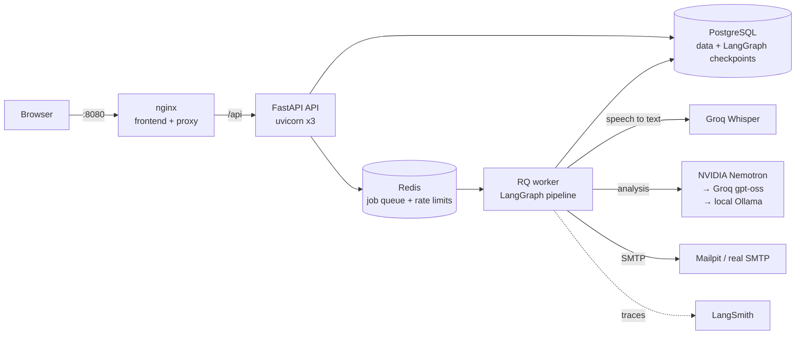
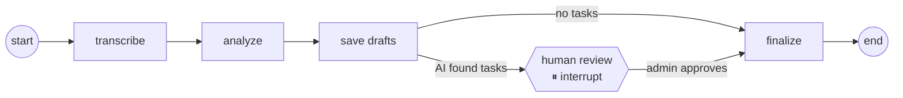
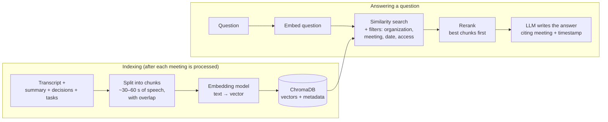
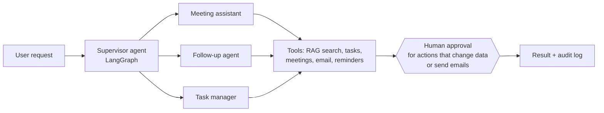

<div align="center">


# MeetMind

**Turn meeting recordings into summaries, decisions, tasks and answers, using open-source AI models.**

Upload a recording → MeetMind transcribes it, writes the summary, finds decisions and open questions,
drafts tasks with owners and due dates, waits for an admin to approve them, emails each owner,
and answers questions about the meeting.


</div>

---

## Contents

1. [What MeetMind does](#1-what-meetmind-does)
2. [How it works](#2-how-it-works)
3. [Tools and technologies (and why each one)](#3-tools-and-technologies-and-why-each-one)
4. [AI models](#4-ai-models)
5. [The AI pipeline step by step](#5-the-ai-pipeline-step-by-step)
6. [Project structure](#6-project-structure)
7. [Getting started](#7-getting-started)
8. [Configuration (.env)](#8-configuration-env)
9. [Using MeetMind](#9-using-meetmind)
10. [API reference](#10-api-reference)
11. [Emails](#11-emails)
12. [Security](#12-security)
13. [Testing](#13-testing)
14. [Useful commands](#14-useful-commands)
15. [Troubleshooting](#15-troubleshooting)
16. [RAG: Retrieval-Augmented Generation (planned)](#16-rag-retrieval-augmented-generation-planned)
17. [Agentic AI: MeetMind agents (planned)](#17-agentic-ai-meetmind-agents-planned)
18. [Roadmap: done and next](#18-roadmap-done-and-next)

---

## 1. What MeetMind does

| Feature | What you get |
|---|---|
| 🎙️ **Transcription** | Upload MP3, WAV, M4A, MP4, WEBM, OGG, FLAC or MOV (up to 500 MB). You get a timestamped transcript. |
| 📝 **AI summary** | A short summary of what was discussed and decided. |
| 🎯 **Strategy shifts** | Decisions that change plans, scope, priorities or dates. |
| ❓ **Open questions** | Things the meeting left unresolved. |
| ✅ **Task extraction** | Action items with owner, due date and the **exact quote** they came from. |
| 🛡️ **Human review** | AI tasks are *drafts*. An admin keeps, edits or discards them before anyone is notified. |
| 📧 **Email notifications** | Invites, "ready for review", "you have new tasks", "processing failed". |
| 💬 **Ask the meeting** | Chat with the meeting: *"Who is booking the demo and when?"* Answers cite timestamps. |
| 👥 **Teams and roles** | Each company gets its own workspace. **Admins** manage meetings and people; **members** see the meetings they attended and their own tasks. |
| 📱 **Responsive UI** | Works on desktop and phone, with automatic dark mode. |

---

## 2. How it works



- **nginx** serves the website and forwards `/api/...` requests to the backend.
- The **API** (FastAPI) handles logins, meetings, tasks and uploads. It never does slow work itself.
- Slow work (transcription, AI analysis, emails) goes onto a **Redis queue**. A separate **worker** picks it up.
- The worker runs the **LangGraph pipeline**, saves results in **PostgreSQL**, and **pauses** for admin review.
- When the admin approves, the API **resumes** the paused pipeline. Its progress was saved in Postgres, so even another process can continue it.

---

## 3. Tools and technologies (and why each one)

### Backend

| Tool | What it is | Why MeetMind uses it |
|---|---|---|
| **Python 3.11** | Programming language | The standard language for AI and ML tools. |
| **FastAPI** | Modern Python web framework | Fast, async-ready. It validates requests with Pydantic and **generates interactive API docs** automatically at `/api/docs`. |
| **Uvicorn** | ASGI web server | Runs FastAPI with 3 worker processes. `--proxy-headers` lets it see real visitor IPs behind nginx. |
| **Pydantic v2** | Data validation | Every request body is checked (emails, lengths, dates, time zones). Bad input gets a clear `422` error. |
| **pydantic-settings** | Settings from environment | All configuration comes from `.env`, with type checking. |
| **SQLAlchemy 2** | Database toolkit / ORM | Talks to PostgreSQL in Python. Every query is filtered by organization (multi-tenancy). |
| **Alembic** | Database migrations | Versioned schema changes. A one-shot `migrate` container applies them before the API starts. |
| **PostgreSQL 16** | Relational database | Stores organizations, users, meetings, transcripts and tasks, plus LangGraph's pipeline checkpoints. |
| **Redis 7** | In-memory data store | 1) job queue for the worker, 2) shared rate-limit counters for all API processes. |
| **RQ (Redis Queue)** | Background job library | Runs transcription, AI analysis and email sending outside web requests, with retries. |
| **argon2-cffi** | Password hashing | Argon2 is the recommended modern password hash. |
| **PyJWT** | JSON Web Tokens | Signed login tokens (`Authorization: Bearer …`) that expire after 8 hours. |
| **limits** | Rate limiting | Stops brute-force logins and abuse: e.g. 10 logins per minute per IP. |
| **Jinja2** | Templates | HTML and plain-text emails, with automatic escaping. |
| **ffmpeg** | Audio/video tool | Converts any recording to small mono speech audio and splits it into chunks. |

### AI and LLM stack

| Tool | What it is | Why MeetMind uses it |
|---|---|---|
| **LangChain** | Standard interface for LLMs | NVIDIA, Groq and Ollama models all use the same `.invoke()` / `.with_structured_output()`. Changing models is configuration, not code. |
| **LangGraph** | Framework for AI workflows as graphs | The meeting pipeline is a state machine with a **human-in-the-loop pause** (`interrupt()`) for admin approval. |
| **LangGraph Postgres checkpointer** | Saves graph state | The worker pauses the pipeline and the API resumes it later, even after restarts. |
| **LangSmith** | Tracing and observability | See every pipeline run, prompt, model output and timing in a dashboard (optional). |
| **NVIDIA AI endpoints** (build.nvidia.com) | Hosted open models | Runs **Nemotron**, NVIDIA's open models, as the primary analysis and chat model. |
| **Groq** | Very fast inference cloud | **Whisper large-v3** for speech-to-text, and **gpt-oss** (OpenAI's open-weight models) as the backup LLM. |
| **Ollama** | Runs models on your own computer | Optional last-resort backup (e.g. `gemma4`), so meetings can still be analysed if both clouds fail. |

### Frontend and infrastructure

| Tool | What it is | Why MeetMind uses it |
|---|---|---|
| **HTML, CSS, JavaScript** (no framework) | Plain web pages | Simple, fast, nothing to build. One design system (`style.css`) with dark mode. |
| **nginx** | Web server / reverse proxy | Serves the frontend, proxies `/api`, adds security headers, allows 500 MB uploads. |
| **Docker + Docker Compose** | Containers | One command starts all 7 services the same way on every machine. |
| **Mailpit** | Fake email inbox for development | Catches every email MeetMind sends. View them at <http://localhost:8025>. |
| **pytest + httpx** | Testing | 60 automated tests run inside Docker. |

---

## 4. AI models

All model names live in `.env`, so you can swap them without touching code.

| Job | Model (provider) | Fallback |
|---|---|---|
| Speech → text | `whisper-large-v3` (Groq) | n/a |
| Meeting analysis | `nvidia/nemotron-3.5-super-vl-120b-a12b` (NVIDIA) | `openai/gpt-oss-120b` (Groq) → `gemma4` (Ollama, optional) |
| Q&A chat | `nvidia/nemotron-3.5-lightning-30b-a3b` (NVIDIA) | `openai/gpt-oss-20b` (Groq) → `gemma4` (Ollama, optional) |

**How the fallback works:** MeetMind tries each configured provider in order and uses the first one that succeeds.
It skips models whose context window is too small for the transcript, and it records which model produced each result
(shown as a small "AI · model" badge on the meeting page).

> Measured on a 1-minute test meeting: NVIDIA analysis ≈ 16 s, Groq ≈ 4 s, local gemma4 on a laptop CPU ≈ 40–70 s.
> Upload → ready for review took ≈ 12–35 s end to end.

---

## 5. The AI pipeline step by step



1. **transcribe**: ffmpeg drops the video and converts the audio to 16 kHz mono Opus (~0.25 MB per minute), then splits it into 10-minute chunks.
   Groq Whisper transcribes each chunk, and timestamps are shifted so they line up with the full recording.
   Participant names are passed to Whisper as spelling hints.
2. **analyze**: one structured LLM call returns `summary`, `strategy_shifts`, `open_questions` and `tasks`.
   The prompt treats the transcript as **data, not instructions**, which protects against prompt injection.
3. **save drafts**: code checks the model's output instead of trusting it:
   - **Evidence check:** each task must quote the transcript (fuzzy word matching). Invented tasks are dropped.
   - **Owner matching:** "Maya", "maya patel" and "maya@company.com" map to the right participant. Ambiguous or unknown → left for the admin.
     Without speaker labels, "I'll do it" has no known speaker, so the owner is not guessed.
   - **Due dates are calculated in Python**, not by the AI. The model copies the spoken words ("by Friday", "next week") and code resolves them
     against the meeting date **in the meeting's own time zone**. (LLMs are unreliable at calendar math.)
   - Deadlines are removed from task titles, and duplicate tasks are merged.
4. **human review** ⏸: LangGraph `interrupt()` pauses the graph and saves its state in Postgres. The meeting shows status **Review**.
   Members can't see drafts. The admin keeps, edits or discards each task.
5. **finalize**: approved tasks become visible to their owners and each owner is emailed. Rejected drafts are deleted.

**Statuses:** `scheduled → processing → review → completed` (or `failed`, with a clear reason and a **Retry** button).

---

## 6. Project structure

```
MeetMind/
├── docker-compose.yml          # all services: api, worker, migrate, postgres, redis, nginx, mailpit
├── .env.example                # copy to .env and fill in
├── nginx/nginx.conf            # serves frontend, proxies /api, security headers
│
├── backend/
│   ├── Dockerfile              # multi-stage: base → test (pytest) / runtime (uvicorn)
│   ├── requirements.txt        # runtime dependencies (pinned)
│   ├── alembic.ini, migrations/  # database migrations
│   ├── meetmind/
│   │   ├── __init__.py         # FastAPI app factory (CORS, errors, rate limits, routers)
│   │   ├── main.py             # entry point: uvicorn meetmind.main:app
│   │   ├── config.py           # settings from .env
│   │   ├── models.py           # database tables
│   │   ├── schemas.py          # request validation
│   │   ├── deps.py             # DB session, current user, admin guard
│   │   ├── security.py         # argon2, JWT, invite tokens
│   │   ├── ratelimit.py        # Redis-backed rate limits
│   │   ├── mailer.py, notifications.py, templates/email/   # emails
│   │   ├── jobs.py             # background jobs run by the worker
│   │   ├── api/                # auth, users, meetings, tasks, dashboard, health
│   │   └── ai/
│   │       ├── llm.py          # providers + fallback (NVIDIA → Groq → Ollama)
│   │       ├── transcription.py# ffmpeg + Groq Whisper
│   │       ├── analysis.py     # prompt, output schema, evidence/owner/date checks
│   │       ├── pipeline.py     # LangGraph graph with interrupt()
│   │       ├── checkpoint.py   # Postgres checkpointer
│   │       └── qa.py           # "ask about this meeting"
│   └── tests/                  # 60 pytest tests (fake AI models, no keys needed)
│
└── frontend/
    ├── index.html              # landing page
    ├── signup.html, login.html, accept-invite.html
    ├── admin.html              # admin dashboard + team management
    ├── member.html             # my tasks + my meetings
    ├── create-meeting.html, meeting.html
    ├── css/style.css           # design system (light + dark)
    ├── assets/                 # logo.svg, icons.svg
    └── js/
        ├── ui.js, api.js, app.js, auth.js, tasks.js
        └── pages/              # admin.js, member.js, meeting.js, create-meeting.js
```

---

## 7. Getting started

### Prerequisites

- [Docker Desktop](https://www.docker.com/products/docker-desktop/) (includes Docker Compose)
- API keys (both have free tiers):
  - **Groq**: <https://console.groq.com/keys> (required for transcription)
  - **NVIDIA**: <https://build.nvidia.com> → open any model → *Get API Key* (key starts with `nvapi-`)
- Optional: **LangSmith** key (<https://smith.langchain.com>) for tracing, **Ollama** (<https://ollama.com>) for a local backup model

### Run it

```bash
git clone https://github.com/tawfeeqimtiyaz/MeetMind.git
cd MeetMind

# 1. Create your settings file
cp .env.example .env
#    then edit .env:
#    - SECRET_KEY: a long random string (python -c "import secrets; print(secrets.token_urlsafe(48))")
#    - POSTGRES_PASSWORD: any strong password
#    - GROQ_API_KEY and NVIDIA_API_KEY

# 2. Start everything (first run builds the images)
docker compose up -d --build

# 3. Check that all services are healthy
docker compose ps
```

| Open | URL |
|---|---|
| MeetMind app | <http://localhost:8080> |
| Interactive API docs | <http://localhost:8080/api/docs> |
| Mailpit (emails) | <http://localhost:8025> |

### First steps

1. Open <http://localhost:8080> → **Get started** → create your workspace (you become its admin).
2. **Team** → invite a colleague → open the email in Mailpit → *Accept invite*.
3. **New meeting** → add participants → open the meeting → upload a recording.
4. Wait for **Review** (the page updates itself) → keep or edit tasks → **Approve**.
5. Ask questions in **Ask about this meeting**.

---

## 8. Configuration (.env)

| Variable | Default | Meaning |
|---|---|---|
| `APP_ENV` | `production` | `development` also logs invite links and shows API docs; `production` hides `/api/docs`. |
| `SECRET_KEY` | (required) | Signs login tokens. At least 32 random characters. |
| `APP_BASE_URL` | `http://localhost:8080` | Public URL used in email links. |
| `CORS_ORIGINS` | `http://localhost:8080` | Allowed browser origins (comma-separated). |
| `ALLOW_SIGNUP` | `true` | Allow anyone to create a new workspace. |
| `JWT_EXPIRES_MINUTES` | `480` | Login session length. |
| `MAX_UPLOAD_MB` | `500` | Largest recording allowed. |
| `POSTGRES_USER` / `POSTGRES_PASSWORD` / `POSTGRES_DB` | | Database credentials. |
| `EMAIL_ENABLED` | `true` | Turn all emails on or off. |
| `SMTP_HOST` / `SMTP_PORT` | `mailpit` / `1025` | Mail server. |
| `SMTP_USERNAME` / `SMTP_PASSWORD` | | Mail server login (not needed for Mailpit). |
| `SMTP_STARTTLS` / `SMTP_SSL` | `false` | Use for port 587 / 465 servers. |
| `MAIL_FROM` | `MeetMind <no-reply@meetmind.local>` | Sender shown in emails. |
| `NVIDIA_API_KEY` | | Enables NVIDIA models. |
| `NVIDIA_ANALYSIS_MODEL` / `NVIDIA_CHAT_MODEL` | Nemotron 3.5 Super / Lightning | Model IDs ([list](https://integrate.api.nvidia.com/v1/models)). |
| `GROQ_API_KEY` | | Enables transcription and Groq models. |
| `GROQ_ANALYSIS_MODEL` / `GROQ_CHAT_MODEL` | `openai/gpt-oss-120b` / `openai/gpt-oss-20b` | Backup LLMs. |
| `GROQ_TRANSCRIPTION_MODEL` | `whisper-large-v3` | Speech-to-text model. |
| `OLLAMA_BASE_URL` | `http://host.docker.internal:11434` | Your local Ollama. |
| `OLLAMA_MODEL` | (empty = off) | e.g. `gemma4:latest`. |
| `OLLAMA_NUM_CTX` | `16384` | Context window for the local model. |
| `LANGSMITH_TRACING` | `false` | `true` sends traces to LangSmith. |
| `LANGSMITH_API_KEY` / `LANGSMITH_PROJECT` | | LangSmith key and project name. |

> ⚠️ Never commit `.env`. It is already in `.gitignore`.

---

## 9. Using MeetMind

**Admins**
- **Dashboard:** live stats, meetings waiting for review, all meetings (filter by status).
- **Team:** invite by email (member or admin), resend invites, disable or enable people.
- **Meeting page:** upload the recording, watch processing live, review AI tasks (tick to keep, change owner or due date, approve),
  add tasks by hand, read the transcript, ask questions, retry failed processing, delete the meeting.

**Members**
- **My work:** their tasks (tick when done), due dates, the meetings they were part of.
- **Meeting page:** summary, decisions, approved tasks, transcript and Q&A. Drafts stay hidden until an admin approves them.

---

## 10. API reference

Full interactive docs: **<http://localhost:8080/api/docs>** (click **Authorize** and paste the token from `/api/auth/login`).

| Method | Endpoint | Who | Purpose |
|---|---|---|---|
| POST | `/api/auth/signup` | anyone | Create a workspace + first admin |
| POST | `/api/auth/login` | anyone | Get a login token |
| POST | `/api/auth/accept-invite` | invitee | Set name + password from an invite |
| GET | `/api/auth/me` | signed in | Current user |
| GET | `/api/dashboard` | signed in | Stat cards |
| GET / POST | `/api/users`, `/api/users/invite` | admin | List team / invite someone |
| POST | `/api/users/{id}/resend-invite` | admin | New invite link |
| PATCH | `/api/users/{id}` | admin | Change role or disable |
| GET / POST | `/api/meetings` | signed in / admin | List / create meetings |
| GET / PATCH / DELETE | `/api/meetings/{id}` | signed in / admin | View / edit / delete |
| POST | `/api/meetings/{id}/recordings` | admin | Upload a recording (starts processing) |
| GET | `/api/meetings/{id}/transcript` | signed in | Transcript with timestamps |
| GET / POST | `/api/meetings/{id}/tasks` | signed in / admin | List / add tasks |
| POST | `/api/meetings/{id}/review` | admin | Approve AI drafts (resumes the pipeline) |
| POST | `/api/meetings/{id}/reprocess` | admin | Retry processing |
| POST | `/api/meetings/{id}/ask` | signed in | Ask a question about the meeting |
| GET | `/api/tasks/mine` | signed in | My tasks |
| PATCH / DELETE | `/api/tasks/{id}` | owner / admin | Update / delete a task |
| GET | `/api/health`, `/api/health/ready` | anyone | Liveness / readiness (Postgres + Redis) |

Errors always look like `{"error": {"code": "…", "message": "…", "details": …}}`.

---

## 11. Emails

| Email | Sent to | When |
|---|---|---|
| Invite | invited person | an admin invites or re-invites them |
| Ready for review | the admin who created the meeting | the AI drafted tasks |
| New tasks for you | each task owner with an account | an admin approved their tasks |
| Processing failed | the admin who created the meeting | a recording could not be processed |

**Development:** every email lands in **Mailpit** (<http://localhost:8025>). Nothing reaches real inboxes.

**Real delivery**, e.g. with Gmail: turn on 2-Step Verification → create an **App Password**
(Google Account → Security → App passwords, 16 letters) → set in `.env`:

```env
SMTP_HOST=smtp.gmail.com
SMTP_PORT=587
SMTP_STARTTLS=true
SMTP_USERNAME=you@gmail.com
SMTP_PASSWORD=your16letterapppassword
MAIL_FROM=MeetMind <you@gmail.com>
```

Then `docker compose up -d --force-recreate api worker`. Never use your normal Google password here.

---

## 12. Security

- **Multi-tenant isolation:** every query is filtered by organization. Other companies' meetings return `404`, not `403`, so IDs can't be probed.
- **Passwords:** Argon2 hashing. Login takes the same time whether or not the email exists.
- **Invite links:** random, single-use, expire after 72 hours, and only their SHA-256 hash is stored.
- **Rate limits** on signup, login, invites and AI questions, shared across all API workers via Redis.
- **Uploads:** login and permissions are checked **before** the file is read, the size is capped, and files are stored under random names (client paths are never trusted).
- **Prompt injection:** transcripts are wrapped and marked as data. AI tasks must quote the transcript or they are dropped. A human approves before anything is shared.
- **XSS:** the frontend never inserts API data as HTML, and emails are auto-escaped.
- **Headers:** nginx sends `X-Content-Type-Options`, `X-Frame-Options` and `Referrer-Policy`. Containers run as a non-root user.
- **Secrets** only live in `.env` (git-ignored). The app refuses to start with a weak `SECRET_KEY`.

---

## 13. Testing

```bash
docker compose --profile test run --rm tests
```

60 tests cover auth, invites, permissions, organization isolation, uploads, rate limits, emails,
the full AI pipeline (review, fallback, evidence checks, owner matching, due dates, time zones) and Q&A.
They use **fake AI models**, so no API keys or internet are needed.

---

## 14. Useful commands

```bash
docker compose ps                                   # status of all services
docker compose logs -f api worker                   # follow backend logs (pipeline decisions appear here)
docker compose up -d --build api worker             # rebuild after backend code changes
docker compose up -d --force-recreate api worker    # reload .env changes
docker compose exec postgres psql -U meetmind       # database shell
docker compose down                                 # stop (data is kept)
docker compose down -v                              # stop AND delete all data
```

---

## 15. Troubleshooting

| Problem | Fix |
|---|---|
| Processing failed: *"Transcription needs GROQ_API_KEY"* | Add `GROQ_API_KEY` to `.env`, run `docker compose up -d --force-recreate api worker`, then click **Retry processing**. |
| *"The AI service is unavailable"* | Check your NVIDIA/Groq keys and quota. Optionally set `OLLAMA_MODEL` as a local backup. |
| Emails don't reach Gmail | In development they go to Mailpit. For Gmail you need an **App Password**, not your normal password. |
| 502 from nginx after a rebuild | Wait a few seconds for the API health check, then refresh. |
| `.env` changes not applied | Containers read `.env` when created: use `--force-recreate`. |
| Ollama not reachable from Docker | Make sure Ollama is running. `OLLAMA_BASE_URL` should be `http://host.docker.internal:11434`. |

---

## 16. RAG: Retrieval-Augmented Generation (planned)

### What RAG is

An LLM only knows what is in its prompt. **RAG** first **retrieves** the most relevant pieces of your own data,
then gives only those pieces to the model so it can **generate** an answer grounded in them, with sources.

Today, *Ask about this meeting* puts the **whole** meeting record into the prompt. That works for one meeting of normal length,
but not for a 3-hour meeting or for questions across **all** meetings. RAG fixes both.

### How it will work in MeetMind



| Step | What happens | Tool |
|---|---|---|
| **Chunking** | Transcripts are split along segment timestamps into overlapping chunks, so each chunk keeps its meeting, time range and speaker. | LangChain text splitters |
| **Embeddings** | Each chunk becomes a vector (a list of numbers that captures its meaning). Similar meanings give nearby vectors. | NVIDIA `nemotron-3.5-embed-1b` **or** a small local embedding model running inside MeetMind (keeps text on your machine) |
| **Vector store** | Vectors and metadata (organization, meeting, date, participants, timestamps) are saved. | **ChromaDB** (its own container, persistent volume) |
| **Retrieval** | The question is embedded and the closest chunks are found. Filters make sure people only search **their own organization**, and members only **meetings they attended**. | LangChain retriever + ChromaDB metadata filters |
| **Hybrid search** | Combines meaning-based search with keyword search, so exact names, numbers and product codes are found too. | ChromaDB + keyword scoring |
| **Reranking** | A second model re-orders the candidates so the best evidence goes into the prompt. | Reranker model (optional) |
| **Generation** | The LLM answers **only** from the retrieved chunks and cites `[meeting, 00:12:30]`. If the answer isn't there, it says so. | Nemotron → gpt-oss → Ollama (same fallback chain) |

### What it unlocks

- **Questions across all meetings:** *"What did we decide about pricing last month?"*, *"Which tasks does Maya have from Q4 planning?"*
- **Meetings of any length:** only the relevant minutes go to the model, so it's cheaper and faster.
- **Answers you can check:** every answer links to the meeting and the exact timestamp.
- **Access control kept:** retrieval respects the same organization and role rules as the API.
- **Measured quality:** retrieval and answers are scored in Phase 8 evals (did the right chunk come back? is the answer faithful to it?).

---

## 17. Agentic AI: MeetMind agents (planned)

### What an AI agent is

A normal LLM call answers once. An **agent** is an LLM that can **decide which tools to use**, call them, look at the results,
and repeat until the job is done. MeetMind already uses **LangGraph**, which is built for exactly this: agents are graphs with
memory, tools and human approval steps.

### Planned MeetMind agents

| Agent | What it does | Tools it can use |
|---|---|---|
| **Meeting assistant** | Answers complex questions by searching meetings, reading tasks and combining results. *"Summarise every decision about the launch since October and who owns the follow-ups."* | RAG search (ChromaDB), list meetings, read transcript, list tasks |
| **Follow-up agent** | After a meeting, drafts the follow-up email, proposes the next meeting agenda from open questions, and suggests reminders for tasks close to their due date. | Read meeting, draft email, create task, schedule reminder |
| **Task manager** | Turns requests into actions: *"Move Alex's prototype task to next Friday and assign the docs to Maya."* | Update task, assign owner, resolve dates |
| **Insights agent** | Finds patterns across meetings: recurring blockers, overdue owners, decisions that were later reversed. | RAG search, task statistics, Neo4j knowledge graph (Stage B) |

### How agents will be built



- **LangGraph tool-calling agents** (ReAct style: *think → call a tool → read the result → continue*).
- **Supervisor pattern:** one agent routes each request to the right specialist agent (multi-agent system).
- **Human-in-the-loop:** reading is automatic, but **anything that changes data or sends email waits for approval**.
  This is the same `interrupt()` used today for task review.
- **Memory:** conversation and user preferences are saved with LangGraph checkpoints and stores, so agents remember context.
- **Guardrails:** permissions are checked inside every tool (an agent can never see another organization's data),
  an optional safety model (e.g. NVIDIA `nemotron-3.5-content-safety`) checks inputs and outputs, and step limits stop runaway loops.
- **Observability:** every agent step, tool call and decision is traced in **LangSmith**.
- **Open models with tool calling:** Nemotron, gpt-oss and gemma4 all support function calling, using the same fallback chain.
- **Possible extensions:** expose MeetMind's tools through **MCP (Model Context Protocol)** so other AI assistants can use them,
  and evaluate **CrewAI** for role-based agent teams.

---

## 18. Roadmap: done and next

### ✅ Done

| Phase | What was built |
|---|---|
| **1. Clean-up and Docker** | Split into `frontend/` + `backend/`, removed the old prototype, Docker Compose stack, `.gitignore`, renamed the project to **MeetMind** everywhere. |
| **2. Backend core** | Organizations, users, roles, invites, JWT auth, meetings, uploads, tasks, Alembic migrations, tests. |
| **Framework switch** | Backend moved from Flask to **FastAPI** (async server, dependency injection, automatic API docs). |
| **3. AI pipeline** | LangGraph pipeline, Groq Whisper, NVIDIA Nemotron with Groq/Ollama fallback, human review with `interrupt()`, Postgres checkpoints, Q&A, LangSmith tracing. |
| **4. Emails** | Jinja2 email templates, queued sending with retries, Mailpit for development, real SMTP support. |
| **5. Live frontend** | Every page connected to the API: dashboards, team management, meeting review, upload progress, chat, signup. |
| **Quality fixes** | Due dates in the meeting's time zone, deadlines computed in code, stricter prompts, worker logs, end-to-end browser test. |

### 🔜 Next

| Phase | Plan |
|---|---|
| **6. RAG with ChromaDB** | Chunk transcripts, create embeddings, store them in **ChromaDB**, hybrid search + reranking, answers with meeting and timestamp citations, questions **across all meetings**. See [section 16](#16-rag-retrieval-augmented-generation-planned). |
| **7. Agentic AI** | **LangGraph** agents with tools: meeting assistant, follow-up agent, task manager, insights agent. Supervisor pattern, human approval for actions, memory, guardrails, LangSmith tracing. See [section 17](#17-agentic-ai-meetmind-agents-planned). |
| **8. Evals, CI and docs** | Test sets that measure AI quality: task recall, date accuracy, retrieval hit rate, answer faithfulness, agent tool-use success. GitHub Actions run tests on every push. |
| **Stage B: Kubernetes** | **Helm** chart for local Kubernetes, **KEDA** to scale workers with the queue length, **Grafana** dashboards, **Neo4j** knowledge graph of people, decisions and tasks across meetings. |
| **Stage C: GPU and Ray** | **KubeRay / Ray Serve** on cloud GPUs to self-host models: faster-whisper, **pyannote speaker diarization** ("who said what", so "I'll do it" gets the right owner) and **vLLM** for open LLMs, switchable through configuration. |

---

<div align="center">

Built by **[Tawfeeq Imtiyaz](https://github.com/tawfeeqimtiyaz)**

</div>
