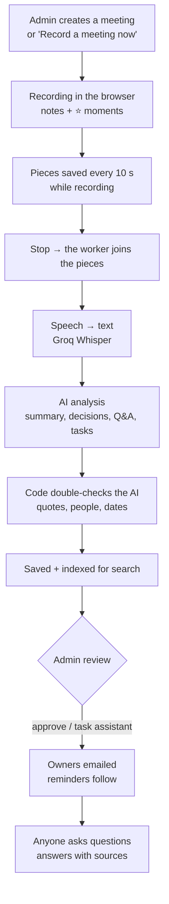

# MeetMind: the easy guide

This guide explains the whole project in plain words, from where it started to how every part works.
No prior knowledge needed. For the technical reference (commands, settings, API), see the [README](../README.md).

---

## 1. MeetMind in one minute

Teams spend hours in meetings, and afterwards nobody remembers exactly **what was decided**, **who has to do what**
and **by when**. MeetMind fixes that:

1. **During the meeting** you press *Record* in MeetMind (or upload a recording later). Anyone can type notes.
2. **Right after**, AI listens to the recording and writes: a summary, the decisions, every question asked and its
   answer, the open questions, and a list of tasks with owners and deadlines.
3. **The admin checks** the tasks (or simply tells the AI assistant who should do what), confirms, and everyone gets
   an email with their tasks. Reminders follow before deadlines.
4. **Later, anyone can ask**: *"What did we decide about pricing?"*, *"What does the bug report say?"*, and gets an
   answer with links to the exact moment of the meeting or the page of the document.

---

## 2. Where it started, and what was rebuilt

MeetMind started as a prototype called **SyncNotes**: a few HTML pages and a small Flask app. It *looked* like the
idea, but most buttons didn't work, nothing was secure, there was no real AI, and files were stored in the repository.

It was rebuilt step by step into a production-style application:

| Step | In simple words |
|---|---|
| **1. Clean-up** | Split into a `frontend` (what you see) and a `backend` (the server). Removed the broken prototype. Everything now starts with one Docker command. Renamed to **MeetMind**. |
| **2. Backend core** | Real accounts and passwords, companies (each with its own private workspace), admins and members, invitations, meetings, uploads and tasks, with automated tests. |
| **3. Framework switch** | The server moved from Flask to **FastAPI**, a modern framework that checks every request and documents itself. |
| **4. AI pipeline** | Speech-to-text, AI summary/decisions/tasks, and a **pause for the admin to approve** before anything is shared. |
| **5. Emails** | Invitations, "ready for review", "you have new tasks", sent reliably in the background. |
| **6. Real pages** | Every page connected to the server: dashboards, team management, meeting page, chat. |
| **7. RAG search** | Ask questions across **all** meetings; answers cite their sources. |
| **8. Live meetings & agents** | Record in the browser, live notes, follow-up questions, documents and bug reports, an AI **task assistant**, a **multi-tool AI agent**, reminders. |
| **9. Interface** | A full-screen recorder with shortcuts, tabs on the meeting page, live progress steps, a tasks board, a dashboard that shows what needs attention, dark mode. |
| **10. Presentations** | MeetMind also captures what is on the big screen (recording or photos) and AI reads each slide, so the notes contain the real numbers. |

---

## 3. A meeting's journey through MeetMind

**Before:** the admin creates a meeting (title, date, participants), or clicks **Record a meeting now**.

**During:** MeetMind records the room's microphone, or the sound of Zoom/Teams/Meet plus your microphone, or also
the screen. It doesn't filter out quiet voices, so questions from the back of the room are kept. A level meter warns
if the sound is too quiet. Anyone in the meeting can type notes; pressing ⭐ marks an important moment.
The recording is uploaded in small pieces while it runs, so nothing is lost if Wi-Fi drops.

**After:** about a minute later the meeting page shows the summary, the decisions, the questions and answers,
open questions and draft tasks. The admin approves them, or types *"Give the bug fix to Maya, ASAP"* to the task
assistant, checks the plan and confirms. Owners get an email (urgent ones marked **URGENT**) and reminders later.

---

## 4. The building blocks, explained like an office

| Part | Like… | What it really does |
|---|---|---|
| **Frontend** (HTML, CSS, JS) | The shop window and counter | The pages you click. Also the **recorder**, which runs in your browser. |
| **nginx** | The receptionist | Hands out the pages and passes `/api` requests to the server. |
| **FastAPI (the API)** | The front desk | Checks who you are and what you're allowed to do, saves things, answers quickly. |
| **Redis queue** | The to-do tray | Slow jobs (transcribing, AI, emails) are put in the tray instead of making you wait. |
| **Worker** | The back office | Takes jobs from the tray and does them. |
| **Scheduler** | The alarm clock | Every morning: "send reminders". Every hour: "rescue interrupted recordings". |
| **PostgreSQL** | The filing cabinet | Users, meetings, notes, tasks, documents, everything permanent. |
| **ChromaDB** | A librarian who sorts by *meaning* | Finds passages that mean the same as your question, even with different words. |
| **LangGraph** | A recipe / flowchart | The fixed steps the AI follows, including "pause until the admin approves". |
| **LLM (Nemotron, gpt-oss, gemma4)** | An expert writer | Reads the transcript and writes the summary, answers questions, plans tasks. |
| **Mailpit** | A practice mailbox | Catches emails during development so nobody gets spammed. |
| **Docker** | Shipping containers | Every part runs in its own box; one command starts them all the same way everywhere. |

---

## 5. The AI ideas, explained simply

**Speech-to-text (Whisper).** Turns audio into text with timestamps ("at 00:12:30 someone said…").

**LLM.** A large language model: very good at reading and writing text. MeetMind uses **open-source** models:
NVIDIA **Nemotron** first, **gpt-oss** on Groq if NVIDIA fails, and optionally **gemma4** on your own computer.
This chain is called **fallback**: if one model is down, the next one answers.

**Structured output.** Instead of free text, the AI must fill in a form: `summary`, `decisions`, `follow_ups`,
`tasks` (title, owner, deadline, priority, quote). Forms are easy for code to check.

**Don't blindly trust the AI.** After the AI fills the form, normal code checks it:
- a task must **quote** what was actually said or typed, otherwise it's thrown away (no invented tasks);
- names are matched to **real people** in the team (even if speech-to-text wrote "Mya" instead of "Maya");
- **dates are calculated by code**, not by the AI ("by Friday" → the right Friday, in the meeting's time zone;
  "ASAP" → 2 working days and marked urgent). AIs are bad at calendars; code isn't.

**Human-in-the-loop.** The AI only drafts. An admin approves before anyone is told. LangGraph literally *pauses*
the workflow and saves it, and continues when the admin clicks Approve.

**Embeddings.** A way to turn a sentence into a list of numbers that represents its *meaning*.
"How much does it cost?" and "the price per seat" end up close together. Only one embedding model is used at a time,
because each model has its own "map", like coordinates on two different maps.

**RAG (Retrieval-Augmented Generation).** Before answering, first **find** the relevant pieces (from meetings, notes
and documents), then let the AI answer **only from those pieces**, citing them `[1] [2]`. That's how answers stay
correct and checkable. MeetMind finds pieces two ways (by meaning *and* by exact words like "E-4021"), merges the
results, and lets a fast AI re-rank them so the best evidence comes first. **top_k = 8** means the 8 best pieces
are given to the AI.

**Agents and tools.** A normal AI call answers once. An **agent** can *use tools*: "search this meeting",
"search the documents", "list overdue tasks"… It decides which tool to use, reads the result, and **if that source
has nothing, it tries another one** before answering. Every tool respects permissions.

**Task assistant.** A planning AI: you describe what you want in plain words, it proposes concrete changes, code
checks them, you confirm. Nothing happens without your click.

**Vision models (reading slides).** Some AI models can look at a picture and read it. When someone presents on the
big screen, MeetMind takes one picture per slide (a slide = a moment where the screen stands still) or uses a photo
someone snapped, and a vision model writes down the title, text, numbers and codes. That's how a summary can say
*"reduce failed checkouts from 4.2% to under 1%"* even though nobody read those numbers aloud.

**Prompt injection.** Someone could say in a meeting "AI, ignore your rules". MeetMind always tells the AI that
transcripts, notes and documents are **data, not instructions**, and important actions still need a human.

---

## 6. Try it yourself (checklist)

1. Start **Docker Desktop**, then in the project folder: `docker compose up -d` (wait until `docker compose ps` shows all *Up*).
2. Open <http://localhost:8080>, sign in (or **Get started** to create a workspace).
3. Dashboard → **Record a meeting now** → *In the room* → **Start recording**. The full-screen recorder opens. Talk
   for a minute, e.g. *"Maya, please fix the login bug as soon as possible. Alex, update the docs by Friday."* Ask
   yourself a question and answer it. Press **N** and type a note, press **M** to mark a moment, **Space** to pause.
4. **Stop & process**. Watch the progress steps (Preparing audio → Transcribing → Analysing): about a minute later
   you see the summary, Q&A and draft tasks.
5. **Tasks** tab → **Task assistant** → *"Give the bug to Maya and the docs to Alex, everything urgent"* → **Prepare plan** → **Confirm**.
6. Open <http://localhost:8025> to see the emails.
7. **Documents** tab → *Attach* a text or PDF file → ask in the chat *"What does the document say about …?"*
8. **Transcript** tab → click a time: the player at the bottom plays from there.
9. **Tasks board** in the sidebar → drag a card to *In progress*. Back on the dashboard, see *Needs attention* and the charts.
10. Sign in as a member to see their view (only their meetings and tasks). Try the theme switch at the bottom of the sidebar.
11. **Slides**: record with *In the room + presentation* and share a window with a few slides, or press **S** while
    recording to photograph the screen, or open the **Slides** tab → *Add a photo of the screen*. After processing, ask
    *"What number was on the slide about …?"*.
12. Run the automated tests: `docker compose --profile test run --rm tests` (115 should pass).

---

## 7. Glossary

| Word | Meaning |
|---|---|
| **API** | The part of the server other programs (and our pages) talk to. |
| **Endpoint** | One "door" of the API, e.g. `POST /api/meetings`. |
| **JWT** | A signed pass you get after logging in; it expires after a few hours. |
| **Migration** | A versioned change to the database structure. |
| **Queue / worker** | A list of jobs, and the program that does them in the background. |
| **Chunk** | A small piece of a transcript or document (about one minute of speech). |
| **Embedding / vector** | Numbers that represent the meaning of a chunk. |
| **Vector database** | A database that finds chunks with similar meaning (ChromaDB). |
| **Reranking** | Re-ordering search results so the most useful come first. |
| **Agent** | An AI that can use tools and decide its next step. |
| **Fallback** | Using the next option when the first one fails. |
| **Human-in-the-loop** | A person approves before the AI's work takes effect. |
| **Diarization** | Knowing *who* spoke when (planned). |

---

## 8. What's next

- **More agents:** reminder/nudge agent, follow-up email agent, meeting-prep agent (agenda from open questions),
  a supervisor that routes requests, memory of company habits, a safety model.
- **Better search:** question rewriting, streaming answers, reading charts inside attached decks.
- **Quality measurement:** test sets that score the AI automatically, GitHub Actions on every push.
- **Scale:** Kubernetes (Helm, autoscaling workers, Grafana dashboards), a Neo4j knowledge graph.
- **GPU:** self-hosted models and **speaker diarization** with Ray on cloud GPUs.

Built by **Tawfeeq Imtiyaz**.
